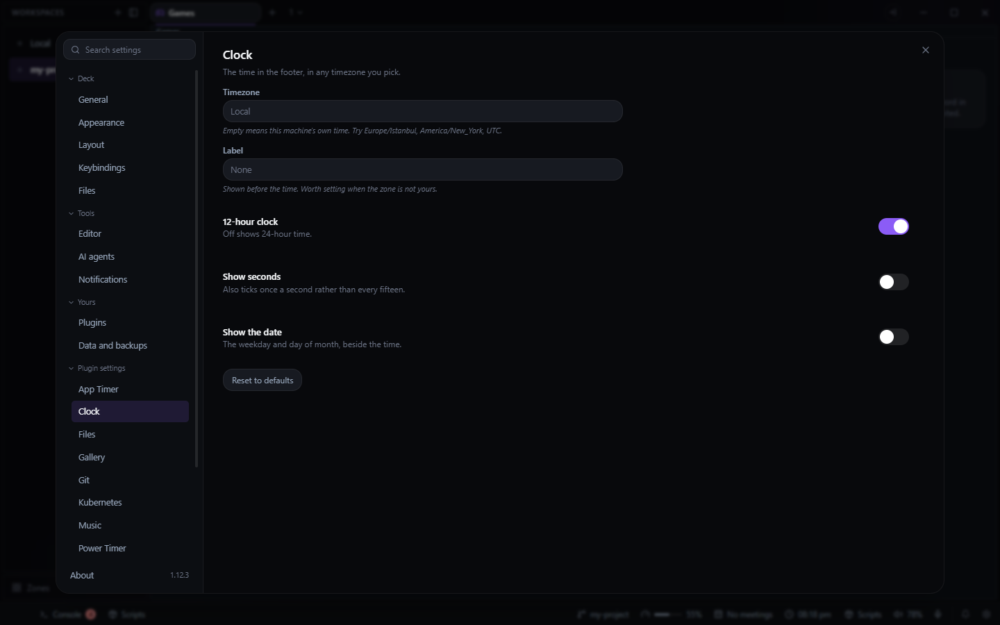

# Clock for Deck

The time in Deck's footer, in whichever timezone you pick. There is no tab: it adds a readout to
the footer.

- **Click the clock** to copy the time, ready to paste into a message. **Clock: copy the time** in
  the command palette does the same.
- Hover it to see which timezone it shows.

## Settings

In Settings > Plugin settings > Clock:

- **Timezone:** any zone this machine knows, such as `Europe/Istanbul`, `America/New_York` or
  `UTC`. Empty shows local time. A name it does not know turns the box red, and the clock shows
  local time until it is fixed.
- **Label:** shown before the time, useful when the zone is not yours.
- **12-hour clock**, **Show seconds** and **Show the date** (the weekday, day and month).
- **Reset to defaults.**

The settings are kept in Deck's config as `plugin-clock`.
